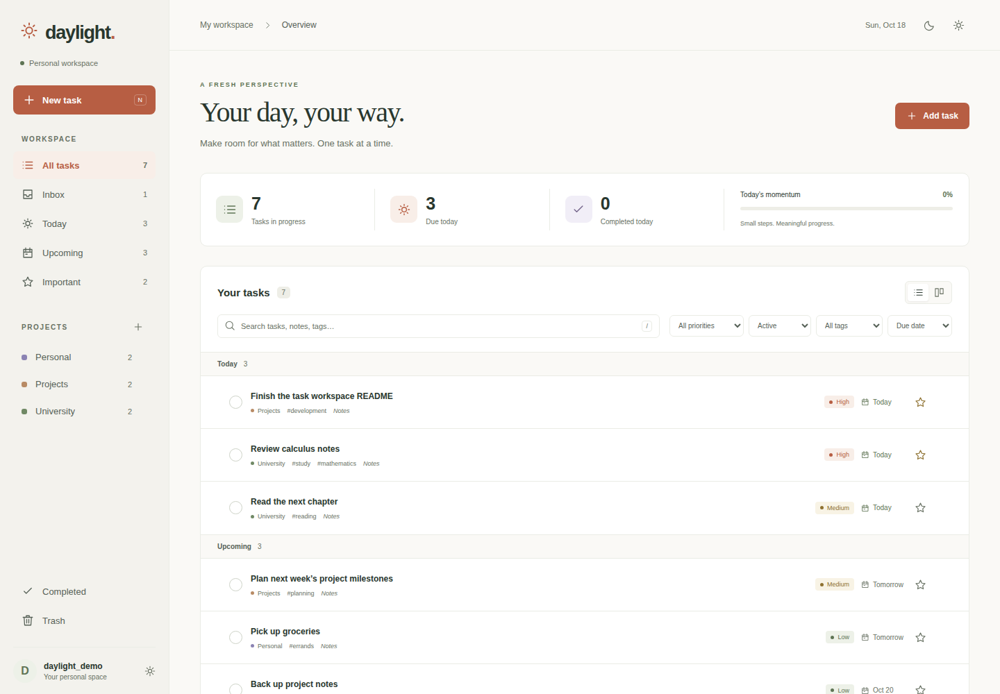
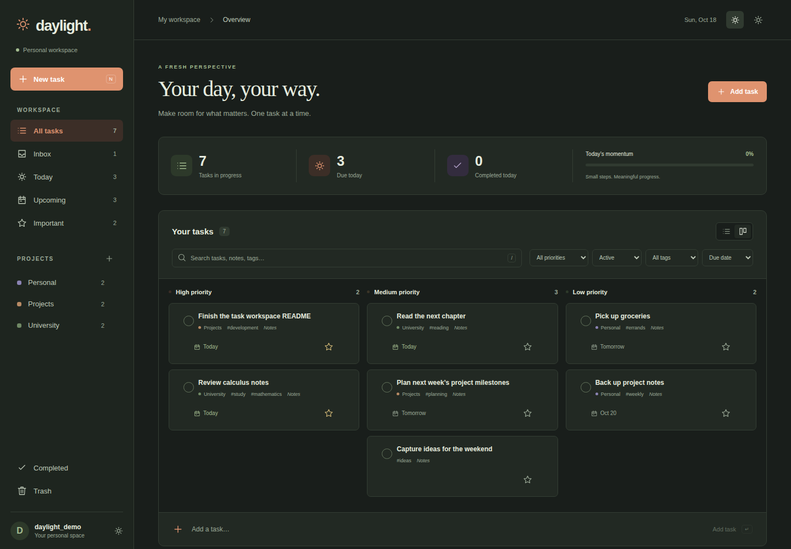
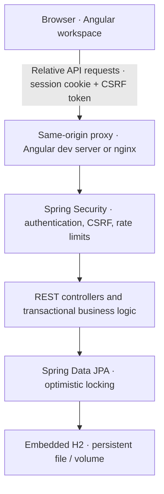

# Daylight

A personal task and project workspace built with Angular 22, Spring Boot 4 and persistent H2 storage.

- **Security:** session authentication, CSRF tokens on every write, BCrypt passwords and account-level data isolation.
- **Automated checks:** GitHub Actions runs frontend formatting, tests and production builds, plus backend integration tests and packaging.
- **Concurrent edits:** version-checked task updates and JPA optimistic locking reject stale edits with `409 Conflict`; the UI reloads the latest data.

## Screenshots

Sample tasks in the running application.





## Run and use

Requirements: Java 17+ (21 recommended), Node.js 24.19.0 and npm 11.16.0.

```sh
git clone https://github.com/Er1cG1ao/full-stack-todo-app.git
cd full-stack-todo-app
./scripts/dev.sh
```

Open [Daylight](http://127.0.0.1:4200), create an account and save the recovery key.
Create tasks with due dates, priorities and subtasks; organize them into projects,
search and filter the list, or switch to the priority board. Recurring tasks generate
their next occurrence on completion. Trash supports undo and restore; JSON export/import
transfers tasks and projects between accounts.

Data persists in `backend/data/`. There are no default accounts. Stop both services with Ctrl+C.

To start each service separately, use two terminals:

```sh
cd backend
./mvnw spring-boot:run
```

```sh
cd frontend
npm ci
npm start
```

Swagger UI is available at `/swagger-ui.html` on the same origin as the app:
[development](http://127.0.0.1:4200/swagger-ui.html) or
[Docker Compose](http://localhost:8088/swagger-ui.html).
For the optional container setup and backups, see the [deployment guide](docs/DEPLOYMENT.md).

## Test

From the repository root:

```sh
(cd frontend && npm ci && npm run check)
(cd backend && ./mvnw --batch-mode --no-transfer-progress verify)
```

Frontend checks cover formatting, unit/component tests and the production build.
Backend tests cover authentication, CSRF, ownership, stale edits, transactional updates,
recurrence, recovery and database migrations. Test databases are isolated from local data.
The [CI workflow](.github/workflows/ci.yml) runs on pushes and pull requests.

## Architecture



## Technical documentation

- [Architecture, data model and request flows](docs/ARCHITECTURE.md)
- [Security and session lifecycle](docs/SECURITY.md)
- [Deployment, backups and operating limits](docs/DEPLOYMENT.md)
- [API usage and interactive documentation](docs/API.md)
- [OpenAPI contract](backend/src/main/resources/static/openapi.yaml)
