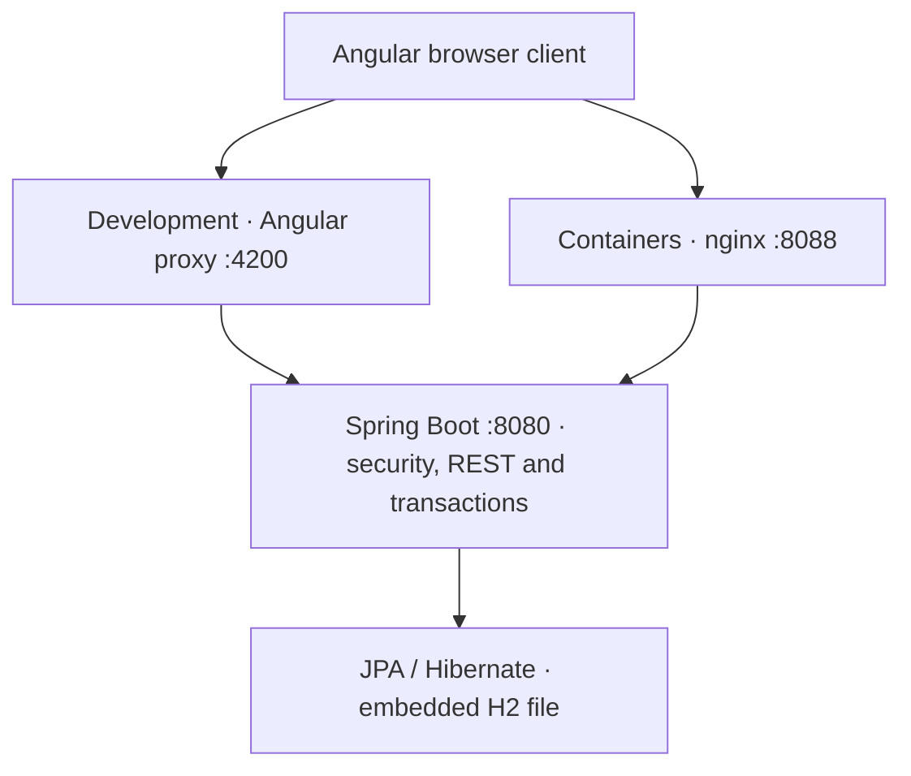

# Architecture and implementation

Daylight is a **single-page frontend plus a single backend application**, maintained
in one repository. Angular renders the interface; Spring Boot authenticates requests,
enforces business rules and persists data. H2 is an embedded relational database inside
the backend process, not a separate authentication server or browser-side store.

The browser talks to the same origin that serves the frontend. The proxy forwards API
traffic to Spring Boot, so the frontend does not need to know the backend's deployment
hostname. In the optional container setup, only nginx is published to the host; the
backend is reachable through the private container network. Locally, the backend binds
to loopback by default. Public HTTPS termination is a separate deployment concern.

### Component responsibilities

| Layer | Main implementation | Responsibility |
| --- | --- | --- |
| Navigation and identity | Angular routes, auth guard, `AuthService` | Protect workspace navigation and restore identity from `/auth/me`; a route guard is a UI convenience, not the security boundary. |
| Workspace and presentation | `Workspace`, task model helpers, theme service | Keep in-memory state, derive task views/statistics, render dialogs and handle loading, errors and user actions. |
| Browser API transport | `ApiService`, session interceptor | Use relative endpoints, include cookies, obtain CSRF tokens for writes and send the browser time zone for task operations. |
| Request security | `SecurityConfig`, auth rate-limit and session-version filters | Authenticate requests, enforce CSRF, limit authentication attempts and reject sessions using outdated credentials. |
| HTTP and business rules | Task/project/backup/auth controllers, `TodoJpaService` | Map requests to operations, validate input, enforce ownership and define transactional changes. Account/project/backup logic currently lives partly in controllers rather than a separate service for every domain. |
| Persistence and schema | JPA entities/repositories, Hibernate, Flyway, H2 | Map objects to relational records, track concurrent edits, persist data and apply versioned schema migrations. |

### Data model and ownership

- **Account (`AppUser`)**: unique username, BCrypt password hash, recovery-key digest,
  credential version and an optimistic-lock version for concurrent account updates.
- **Task (`TodoEntity`)**: belongs to one account through `user_id`; stores its title,
  notes, due date, completion status, priority, project name, tags, recurrence, star,
  timestamps, edit version and whether its next recurrence has already been generated.
- **Project (`Project`)**: belongs to one account and has a name/color. The database
  enforces uniqueness of the project name within that account.
- **Embedded task details**: subtasks are serialized as JSON in the task record; tags
  are normalized comma-separated text. They are not separate relational tables.

Tasks currently store the **project name**, not a project foreign key. An empty name
means Inbox. The backend checks that a selected project belongs to the current user;
renaming a project updates matching tasks, including trashed tasks, in the same
transaction. Removing a project moves its tasks to Inbox rather than deleting them.

The authenticated server principal determines ownership. Task lookups combine the
task ID and the current user's account ID; knowing another user's task ID does not
grant access. Imported usernames and record IDs cannot redirect data to another account.
Passwords and recovery-key plaintext never become part of task backups.

## How it works

### 1. Registration, login and session restoration

1. Before a state-changing request, the Angular interceptor requests `/auth/csrf`
   and attaches the returned token under the header name supplied by the server.
   This applies to registration, login, recovery and logout as well as task writes.
2. Registration validates the username/password, stores a BCrypt hash and a digest
   of a randomly generated recovery key, and returns the key once. The frontend then
   signs in and asks the user to save the key before entering the workspace.
3. Login submits form-encoded credentials to Spring Security. Successful authentication
   creates a server-side session; the browser receives an HttpOnly `JSESSIONID` cookie.
   This is session authentication, not a JWT stored in local storage.
4. The frontend calls `/auth/me` to establish its in-memory identity. On a page reload,
   the auth guard checks the server again rather than trusting a cached username.
5. Protected requests carry the session cookie. A `401` response clears frontend
   identity and redirects to login. The backend independently protects the API even
   if someone bypasses Angular navigation or sends requests directly.

Changing a password increments the account's credential version and invalidates the
current session. Other sessions are rejected on their next request when their stored
version no longer matches. Recovery verifies a saved key, changes the password and
consumes that key; a replacement must be generated after signing in. Authentication
rate limits and sessions are held in backend memory, so they are not shared across
multiple backend instances.

### 2. Loading and displaying the workspace

The workspace fetches non-trashed tasks, trashed tasks and projects in parallel using
RxJS `forkJoin`, then stores them in Angular signals. Computed signals and task helpers
derive the selected view, search results, filters, ordering, groups and progress
statistics from that data. Switching views does not require a separate server query
for each filter. Non-trashed tasks include both completed and incomplete tasks.

After a successful mutation, the workspace reloads server data instead of assuming
that a local edit captured every side effect. For example, completing a recurring
task can create another task. A load-sequence counter prevents an older response from
overwriting a newer load. This is request-driven synchronization, not WebSockets,
background polling or offline sync; changes made elsewhere appear after a reload or
another operation that reloads data.

### 3. Creating and editing a task

1. The editor builds a task payload; `ApiService` sends it through the interceptor.
2. Spring Security checks the session and CSRF token before the controller runs.
3. The controller obtains the username from the authenticated principal. The task
   service validates field lengths, allowed values, subtasks and project ownership.
4. JPA persists the entity within a transaction. The response includes the saved
   task and its edit version; the frontend reloads the workspace and shows feedback.

Updates to `/api/tasks/{id}` must include the version last read by the client. The
service checks that version, and Hibernate's `@Version` also detects concurrent
database updates. A stale edit returns `409 Conflict` rather than silently overwriting
newer data. The workspace reports the conflict and reloads; it does not automatically
merge competing edits. Bulk actions validate all selected task ownership and run in
one transaction, so a failure rolls back the operation rather than leaving partial work.

### 4. Completion, recurrence and Trash

Completing a task records its completion timestamp; reopening clears it. When a
recurring task transitions from incomplete to complete, the backend creates its next
occurrence in the same transaction. The next due date is one day, week or month after
the later of the original due date and today (today is used when no due date exists).
Its completion state and subtask checkboxes are reset. A persisted generation flag
prevents reopening and completing the original again from creating another copy.

Due dates are calendar dates, while audit timestamps are instants. The browser sends
its IANA time zone in `X-Time-Zone`; recurrence uses that zone to determine today,
falling back to the server date when the header is absent. This is completion-triggered
recurrence, not a scheduled job or a timed notification service.

Deleting a task sets `deletedAt` rather than removing the row. Trash queries select
those records; undo/restore clears the timestamp. Permanent deletion requires the
task to be in Trash first and then removes its database record.

### 5. Persistence, migrations and backups

Task/account/project data survives backend restarts because H2 writes to disk. Sessions
do not survive restarts. On startup, Flyway applies pending SQL migrations; Hibernate
then validates that the schema matches the entities instead of silently altering it.
The migration path also supports the original database without assigning passwords
to legacy accounts that had none.

JSON export includes the current user's tasks (including Trash) and projects. Import
validates the format and limits, adds missing projects and creates new task records
under the signed-in account in one transaction. Existing project colors are retained
when names match; invalid data rolls back the import. Imported tasks receive fresh IDs
and creation/update timestamps, so this is an additive transfer, not an exact database
restore or deduplicating sync. Importing the same file twice duplicates its tasks.

For full-fidelity recovery, stop the backend and use the database backup script instead.
That backup includes credentials and all accounts, so it must remain private and must
not be committed to the public repository.
